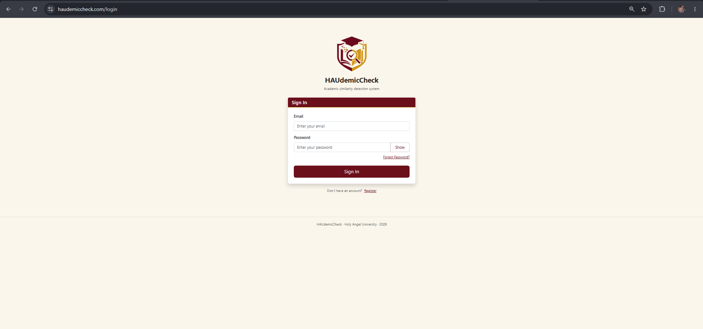
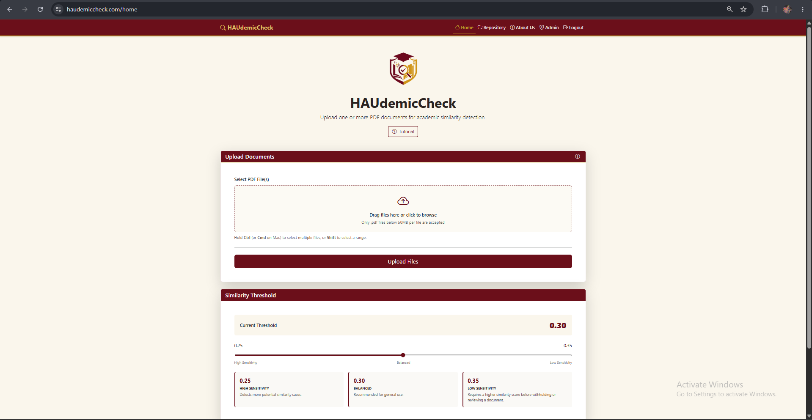
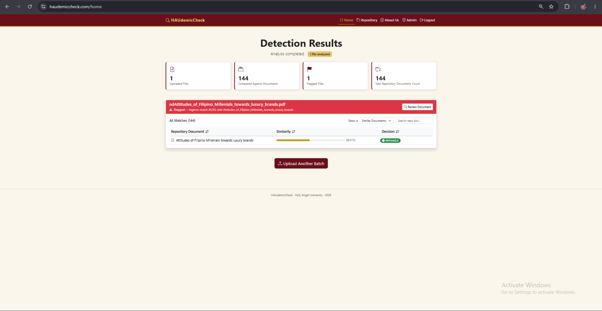
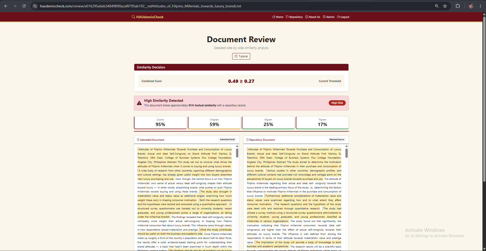
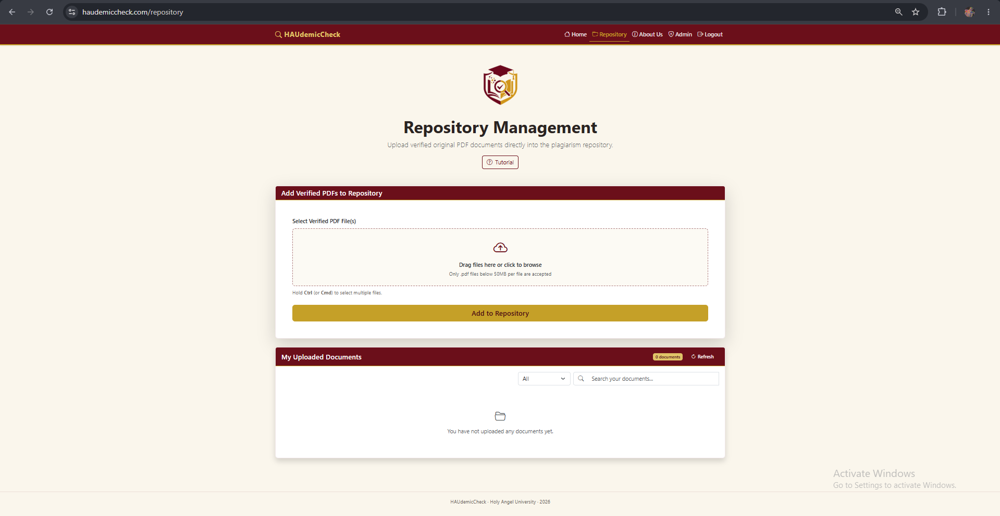
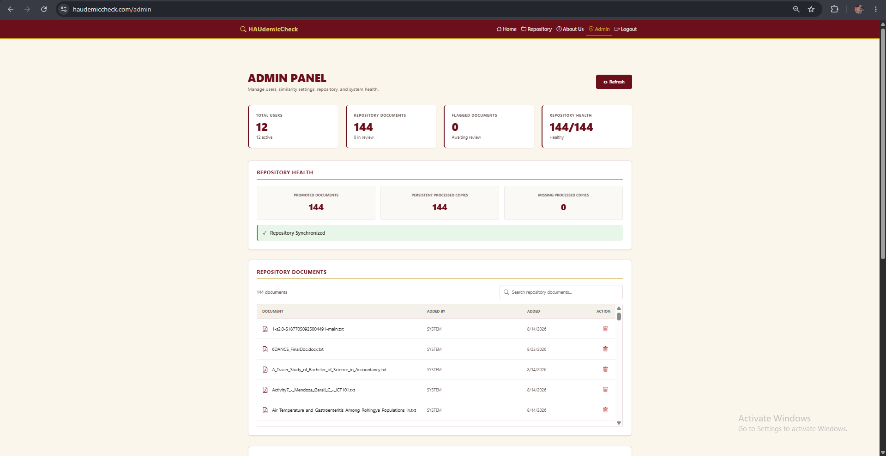
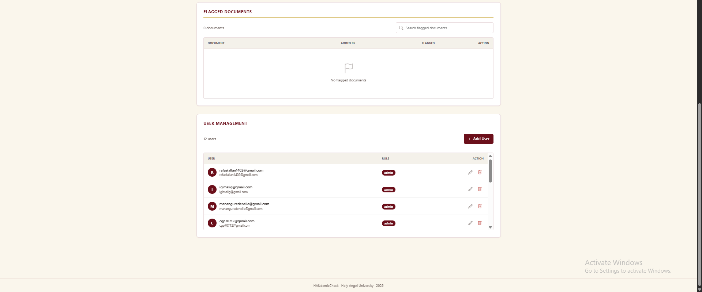

# HAUdemicCheck

Web-Based Academic Document Similarity Detection System Using Hybrid NLP Techniques & Configurable Threshold Evaluation

## 1. Overview

HAUdemicCheck is a web-based academic document similarity detection system developed to assist instructors in identifying textual similarities among academic documents. It applies hybrid Natural Language Processing (NLP) techniques to compare submitted documents with an institutional reference repository and provide similarity results for instructor review.

The system is designed as a decision-support tool. It presents similarity measurements and potentially similar passages to assist the instructor's evaluation process rather than making an automatic determination of plagiarism.

## 2. Setup and installation

### Prerequisites

Install the following before setting up the project:

- Python 3.x
- Git
- pip
- A Supabase project
- A modern web browser
- Visual Studio Code or another Python-compatible IDE (optional)

The project uses Python, Flask, NLTK, scikit-learn, NumPy, Pandas, SciPy, PyMuPDF, pdfplumber, pdfminer.six, pypdfium2, Pillow, Supabase, PyJWT, Cryptography, Flask-WTF, WTForms, Jinja2, and Bootstrap.

Python dependencies are managed through `requirements.txt`.

### Clone the repository

```bash
git clone https://github.com/rdAlva/Bente-Tres-Thesis-Project.git
git checkout dev
git pull origin dev
python -m venv venv
venv\Scripts\activate
python run.py
```

### Install dependencies

```bash
pip install -r requirements.txt
```

### Supabase setup

HAUdemicCheck uses Supabase for persistent application data, authentication, and document storage.

The project uses:

- Supabase PostgreSQL for persistent application records
- Supabase Authentication for user authentication
- Supabase Storage for document files
- The `hau-corpus` storage bucket for corpus-related files

The storage areas used by the application are:

```text
hau-corpus/
├── promoted/
├── processed/
└── review/
```

The application requires the corresponding Supabase project configuration, authentication setup, database tables, and `hau-corpus` storage bucket to be available before use.

The institutional corpus is synchronized from Supabase Storage for document processing. The local runtime cache is a working cache and is not intended to replace the persistent Supabase copy.

### Database and corpus setup

The project materials specify Supabase PostgreSQL and the application's database records, including user profiles and document metadata. The institutional document corpus is stored through Supabase Storage.

There is no verified standalone database seed command in the project materials. Therefore, database tables and initial institutional data should be configured in the Supabase project according to the project's existing schema and deployment configuration rather than using an invented seed command.

## 3. How to run it

Access the link for public access:
https://haudemiccheck.com/

Use this credentials:
User: instructorbentetres@gmail.com
Password: instructorpassword23

OR Access it through local means:

```bash
git clone https://github.com/rdAlva/Bente-Tres-Thesis-Project.git
git checkout dev
git pull origin dev
pip install -r requirements.txt
python -m venv venv
venv\Scripts\activate
python run.py
```


If the Flask application is not automatically detected, configure the application entry point used by the project and then run Flask.

A successful local run should expose the application at an address similar to:

```text
http://127.0.0.1:5000
```

Open the displayed address in a modern web browser.

Unauthenticated users are directed to the HAUdemicCheck login page. After successful authentication, authorized users can access the application's document similarity detection workflow.

### For Docker Setup
For first time install
- Collect .env file from researchers
- Place .env file in folder
- Press the navbar of that folder and type powershell
- enter `docker pull gabluigi/haudemicheck:latest`
- then `docker run -d --name haudemicheck-app --env-file .env -p 5000:5000 gabluigi/haudemicheck:latest`
- enter `docker ps`
- then visit http://localhost:5000
- enter this to stop `docker stop haudemicheck-app`

For running after first install
- Open folder where the .env is located
- Press the navbar of that folder and type powershell
- enter this to start `docker start haudemicheck-app`
- then visit http://localhost:5000
- enter this to stop `docker stop haudemicheck-app`


## 4. Features and usage

### Main features

- User authentication
- Instructor and administrator access control
- Academic PDF document upload
- Text extraction
- Text preprocessing
- TF-IDF vectorization
- Cosine Similarity
- Unigram Jaccard Similarity
- Bigram Jaccard Similarity
- Trigram Jaccard Similarity
- Combined similarity scoring
- Configurable similarity threshold
- Institutional reference repository
- Self-augmenting repository behavior
- Document-level similarity results
- Sentence-level similarity review
- Similarity highlighting
- Instructor review of flagged documents
- Repository promotion and dismissal actions
- Supabase-backed document storage
- Administrative repository and user management
- About Us page

### Primary workflow

1. **Log in**
   An authorized instructor signs in to the system.

2. **Upload documents**
   The instructor uploads academic PDF documents for similarity analysis.

3. **Text extraction and preprocessing**
   The system extracts text from the uploaded documents and prepares the text for analysis.

4. **Similarity analysis**
   The system compares submitted documents against the current institutional reference repository using:
   - TF-IDF and Cosine Similarity
   - Unigram Jaccard Similarity
   - Bigram Jaccard Similarity
   - Trigram Jaccard Similarity

5. **Combined similarity and threshold evaluation**
   The component similarity measures are combined into the system's combined similarity score. The score is then evaluated against the configured similarity threshold.

6. **Promotion or review**
   Documents below the configured threshold can proceed through the repository promotion workflow. Documents meeting or exceeding the threshold are withheld for instructor review.

7. **Repository growth**
   Promoted documents become part of the institutional reference repository. Because processing is sequential, a document promoted earlier in the same submission batch may be available as a repository comparison document for a later document in that batch.

8. **Review flagged documents**
   The instructor can inspect similarity scores, repository matches, similar passages, sentence-level matches, and highlighted text.

9. **Instructor decision**
   For a flagged document, the instructor can dismiss the flag and promote the document to the repository or confirm the flag and retain the document in the review repository.

### Similarity metrics

**Cosine Similarity** measures similarity between the TF-IDF representations of documents and captures similarity in their overall term patterns.

**Unigram Jaccard Similarity** measures overlap in individual words.

**Bigram Jaccard Similarity** measures overlap in two-word sequences.

**Trigram Jaccard Similarity** measures overlap in three-word sequences.

The Review page provides explanatory tooltips for these metrics. The tooltips reuse the displayed similarity values and explain what each metric measures. They do not perform additional calculations or determine plagiarism.

### Repository management

The institutional reference repository contains documents promoted through the repository workflow. Repository documents and associated metadata are persisted using Supabase.

### Administrator functions

Authorized administrators can manage system-level functions such as:

- User management
- Repository management
- Similarity threshold configuration
- Repository monitoring
- Flagged document monitoring
- Repository health information
- System statistics

## 5. Project structure

```text
HAUdemicCheck/
│
├── app/
│   ├── frontend/
│   │   └── main.py
│   │
│   ├── nlp/
│   │   ├── preprocessing.py
│   │   ├── ngrams.py
│   │   ├── vectorizer.py
│   │   └── loader.py
│   │
│   ├── services/
│   │   ├── detector.py
│   │   └── review.py
│   │
│   ├── repository/
│   │   └── repository.py
│   │
│   ├── storage/
│   │   └── supabase_storage.py
│   │
│   ├── templates/
│   │   ├── base.html
│   │   ├── index.html
│   │   ├── review.html
│   │   ├── repository.html
│   │   ├── admin_dashboard.html
│   │   ├── about.html
│   │   └── ...
│   │
│   ├── static/
│   │   ├── css/
│   │   ├── js/
│   │   └── file/
│   │
│   └── utils/
│       ├── pdf_extractor.py
│       └── txtFileUpload/
│
├── corpus/
│   ├── promoted/
│   ├── processed/
│   └── review/
│
├── runtime_cache/
│   └── corpus/
│
├── logs/
│
├── requirements.txt
├── .env
├── .env.example
└── README.md
```

### Important components

| Component | Purpose |
|---|---|
| `app/frontend/main.py` | Flask application, routes, authentication, uploads, and administrative functions |
| `app/nlp/preprocessing.py` | Text preprocessing |
| `app/nlp/ngrams.py` | N-gram generation |
| `app/nlp/vectorizer.py` | TF-IDF/vectorization functionality |
| `app/nlp/loader.py` | Corpus loading and synchronization |
| `app/services/detector.py` | Document similarity detection workflow |
| `app/services/review.py` | Similarity review and report preparation |
| `app/repository/repository.py` | Repository upload and promotion workflow |
| `app/storage/supabase_storage.py` | Supabase Storage operations |
| `app/templates/` | HTML/Jinja frontend templates |
| `app/static/` | Frontend CSS, JavaScript, and application static files |
| `corpus/` | Local corpus-related directories |
| `runtime_cache/` | Runtime synchronized corpus cache |
| `logs/` | Detection and similarity result logs |
| `requirements.txt` | Python dependency list |

## 6. Screenshots

### Login




### Home / Upload




### Detection Results




### Review Page




### Repository




### Admin Dashboard





